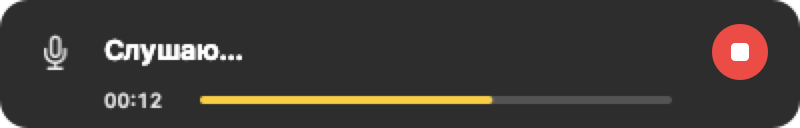
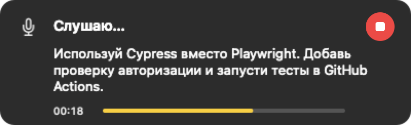

# Голосовая диктовка для macOS с AI-постобработкой

Надиктовываете текст в **любое** текстовое поле (браузер, заметки, редактор, терминал,
TUI OpenCode) — система распознаёт речь локально через Whisper, прогоняет текст через
выбранный AI-провайдер (орфография, пунктуация, заглавные) и вставляет готовый текст
в активное окно.

Ничего никуда не отправляется, кроме самого текста в выбранную вами модель.
Поддерживаются OpenCode, OpenAI-совместимый и Anthropic-совместимый API.

---

## Содержание

- [Возможности](#возможности)
- [Быстрый старт](#быстрый-старт)
- [Скриншоты](#скриншоты)
- [Структура проекта](#структура-проекта)
- [Приложение (menu bar)](#приложение-menu-bar)
- [Требования](#требования)
- [Установка из DMG](#установка-из-dmg)
- [Установка с нуля](#установка-с-нуля)
- [Как это работает](#как-это-работает)
- [Окно статуса (HUD)](#окно-статуса-hud)
- [Конфигурация](#конфигурация)
- [Командный интерфейс](#командный-интерфейс)
- [Промпт](#промпт)
- [Производительность](#производительность)
- [Логи и диагностика](#логи-и-диагностика)
- [Решение проблем](#решение-проблем)
- [Обслуживание](#обслуживание)
- [Ограничения](#ограничения)
- [Тестирование](docs/testing.md)
- [Feature requests](docs/feature-requests.md)
- [Удаление](#удаление)

---

## Возможности

- **Работает в любом приложении** — текст вставляется через ⌘V в активное окно.
- **Локальное распознавание** — Whisper (`large-v3-turbo` и другие модели) с VAD, без облака.
- **Whisper внутри приложения** — `whisper-server` уже в бандле, Homebrew не нужен.
- **Менеджер моделей** — скачивание из каталога, выбор уже скачанных `ggml-*.bin`, свои папки.
- **Постобработка через AI** — исправление ошибок, пунктуации, формулировок.
- **Несколько AI-провайдеров** — профили OpenCode, OpenAI-совместимого и
  Anthropic-совместимого API с отдельными моделями. Для диктовки и улучшения можно
  выбрать разные профили.
- **Улучшение выделенного текста** — выделить фрагмент в любом редакторе и нажать
  **⌥⌘E**: модель переписывает его по отдельному промпту и заменяет на месте.
- **История распознаваний** — просмотр, поиск и копирование прошлых текстов.
- **Один режим** — распознать речь и исправить текст перед вставкой.
- **Плавающее окно статуса** — видно всё время обработки, не забирает фокус.
- **Два глобальных хоткея**, устойчивых к авто-повтору клавиши.

## Быстрый старт

| Клавиши | Действие |
|---|---|
| **⌥ Space** | начать запись / остановить и вставить |
| **⌥ ⌘ E** | улучшить выделенный текст и заменить его на месте |

Хоткей диктовки одинаковый для приложения `Runvoice` и для CLI-режима.
Хоткей улучшения работает только в приложении.

Настройка AI:

1. **Настройки → Провайдеры → + Добавить провайдера**.
2. Выберите тип **OpenCode**, **OpenAI-совместимый** или
   **Anthropic-совместимый**, укажите модель и ключ (для API-типов).
3. В **Настройки → Постобработка** выберите провайдера для диктовки и отдельно
   для улучшения текста. Можно выбрать разные профили.

Порядок диктовки:

1. Поставить курсор в нужное поле.
2. **⌥Space** — рядом с текстовым курсором появится окно: «Готовлю микрофон…» → «Слушаю…». Если координаты каретки недоступны, используется позиция мыши в момент хоткея. Положение окна сохраняется до конца диктовки.
3. Проговорить текст: в бабле начнёт появляться предварительное распознавание.
4. **⌥Space** снова — «Распознаю…» → «Обрабатываю текст…» → «Готово»; итоговый текст показан в том же бабле и вставлен в поле.

Улучшение текста:

1. Выделить фрагмент в редакторе, поле ввода или браузере.
2. **⌥⌘E** — появится «Улучшаю текст…».
3. Готовый текст заменит выделение. Если фокус успел уйти в другое окно,
   улучшенный текст будет скопирован, а не вставлен.

---

## Скриншоты

Все состояния HUD и вкладки настроек — в [`docs/screenshots/`](docs/screenshots/README.md).





---

## Структура проекта

```
self/runvoice/
├── app/
│   ├── main.swift          # точка входа NSApplication
│   ├── Core/               # модель и утилиты без UI
│   │   ├── Paths.swift     # пути приложения
│   │   ├── Log.swift       # app.log
│   │   ├── Settings.swift  # Settings, HotKeySetting, SettingsStore, промпты
│   │   ├── Diagnostics.swift  # проверка зависимостей
│   │   ├── CorrectionTester.swift  # AIClient и проверка подключения
│   │   └── DictationState.swift  # состояния HUD
│   ├── App/                # логика приложения
│   │   ├── AppDelegate.swift     # меню, состояния, вставка, улучшение
│   │   ├── HotkeyMonitor.swift   # глобальные хоткеи (CGEventTap)
│   │   ├── SelectionService.swift # выделение: AX + fallback через буфер
│   │   └── DictationRunner.swift # запуск dictate.sh
│   ├── UI/                 # визуальные компоненты
│   │   ├── BubbleView.swift      # форма бабла
│   │   ├── HUDController.swift   # окно статуса
│   │   ├── ProviderEditor.swift  # форма добавления/редактирования AI-профиля
│   │   └── SettingsWindow.swift  # настройки (Основные/Распознавание/Провайдеры/Постобработка/История/Хоткеи)
│   └── Info.plist
├── bin/
│   ├── dictate.sh          # пайплайн (используют и приложение, и CLI)
│   ├── pastev.c            # ⌘V по коду клавиши
│   ├── dictatehud.swift    # HUD для CLI-режима
│   ├── pastev              # (собирается, в git не попадает)
│   └── dictatehud          # (собирается, в git не попадает)
├── config/
│   ├── skhdrc.tmpl         # шаблон хоткеев → ~/.skhdrc
│   └── whisper-server.plist.tmpl   # шаблон LaunchAgent
├── scripts/
│   ├── build-app.sh        # сборка .app (все .swift из app/)
│   ├── install-app.sh      # установка .app
│   ├── make-dmg.sh         # два DMG: Apple Silicon и Intel
│   ├── bundle-whisper.sh   # статические whisper-бинарники в бандл
│   ├── make-icon.sh        # генерация .icns
│   └── genicon.swift
├── install.sh              # CLI-режим (skhd)
├── Makefile                # make app / install-app / dmg / install
├── README.md
├── dist/                   # (собирается, в git не попадает)
└── .gitignore
```

### Архитектура приложения

- **Core** — модель и утилиты без UI: `Settings` (настройки, промпты, хоткеи),
  `Paths`, `Log`, `Diagnostics` (зависимости), `DictationState`,
  `WhisperModels` (каталог/поиск моделей), `ModelDownloader` (загрузка с SHA-256).
- **App** — `AppDelegate` (меню, состояния, вставка ⌘V), `HotkeyMonitor`
  (глобальные хоткеи через CGEventTap), `DictationRunner` (запуск `dictate.sh`).
- **UI** — `HUDController` (бабл и его позиционирование), `BubbleView` (форма),
  `SettingsWindow` (вкладки Основные / Распознавание / Постобработка / История / Хоткеи).

Сборка (`scripts/build-app.sh`) компилирует все `.swift` из `app/`, точка входа —
`app/main.swift`.

Скрипт находит своих помощников относительно собственного расположения
(`SCRIPT_DIR`), поэтому каталог проекта можно перемещать.

## Приложение (menu bar)

Проект работает в двух режимах. Хоткей диктовки общий; улучшение выделенного
текста доступно только в приложении.

| | Приложение `Runvoice.app` | CLI |
|---|---|---|
| Запуск | значок в строке меню | скрипт + `skhd` |
| Хоткеи | диктовка и улучшение, регистрирует сам (Carbon) | только диктовка через `skhd` |
| Окно статуса | внутри приложения | отдельный `dictatehud` |
| Данные | `~/Library/Application Support/Runvoice/` | `${TMPDIR}/opencode-dictate/` |
| Разрешения | у `Runvoice` | у `skhd` |

### Сборка и установка

```sh
make install-app        # собрать и установить в /Applications
```

или:

```sh
./scripts/install-app.sh
```

Скрипт собирает `dist/Runvoice.app` (иконка + ad-hoc подпись), копирует его в
`/Applications` (или `~/Applications`, если нет прав), **останавливает `skhd`**
(хоткеи теперь у приложения) и запускает.

Только собрать: `make app` → `dist/Runvoice.app`.

### Меню

- **Диктовка** ⌥Space
- **Улучшить текст** ⌥⌘E
- **Настройки…**
- Открыть лог
- Открыть папку данных
- Выход

Значок в строке меню: **волна** (как у иконки приложения) в покое → **микрофон**
во время записи → **многоточие** при правке → **искры** при улучшении текста →
**галочка/предупреждение** на пару секунд.

Runvoice работает **только в строке меню**, без значка в Dock и переключателе ⌘Tab.
Открытие настроек и переполнение строки меню этот режим не меняют.
Если значок скрыт вырезом или другими значками, освободите место в строке меню.

### Разрешения

- **Accessibility** → `Runvoice` (вставка ⌘V через `pastev`).
- **Microphone** → `Runvoice` (запись).

Приложение само показывает системные запросы при запуске. Текущий статус доступа
виден в **Настройки… → Диагностика** (там же кнопка перехода в системные настройки).

### Подпись и стабильные разрешения

Приложение подписывается локальным self-signed сертификатом **`Runvoice Local Signing`**
(создаётся один раз, файлы лежат в `~/.config/runvoice`). Благодаря сертификату
подпись не меняется между пересборками, и macOS **не сбрасывает Accessibility**.

Если сертификата нет, `build-app.sh` подпишет ad-hoc — тогда после каждой
пересборки разрешение придётся выдавать заново.

Проверить подпись:

```sh
codesign -d -r- /Applications/Runvoice.app
# designated => ... and certificate leaf = H"..."
```

### Настройки

Меню → **Настройки…** (или запуск приложения с `--settings`). Шесть вкладок:
**Основные / Распознавание / Провайдеры / Постобработка / История / Хоткеи**.

**Основные**:

| Поле | Что задаёт |
|---|---|
| Язык распознавания | `WHISPER_LANG` (`ru` / `en` / `auto`) |
| Микрофон | `MIC_NAME`; кнопка «Проверить» пишет 1 секунду и показывает уровень |
| Возвращать прежний буфер обмена | `DICTATE_RESTORE_CLIPBOARD` |
| Запускать при входе | регистрирует приложение в Login Items (`SMAppService`) |
| Показывать всплывающий бабл статуса | включает/выключает HUD в приложении |
| Диагностика | Accessibility, ffmpeg, активная модель, OpenCode |

Встроенные `whisper-server`, `whisper-cli` и VAD-модель в диагностике не
показываются — они всегда входят в бандл. Длинные пути можно прочитать в
подсказке при наведении.

**Распознавание** (модели Whisper):

- Список уже найденных моделей: `~/Library/Application Support/Runvoice/models/`,
  `~/.local/share/whisper/`, `~/whisper.cpp/models/` и добавленные вручную папки.
- Можно скачать `tiny`, `base`, `small`, `large-v3-turbo-q5_0`, `large-v3-turbo`,
  `large-v3` из Hugging Face. После загрузки проверяется SHA-256.
- У скачивания видны прогресс, скорость и остаток; при нехватке места кнопка
  блокируется.
- «Обновить» перечитывает папки; «Открыть папку моделей» открывает Finder.
- «Показать в Finder» показывает файл; «Скрыть» убирает внешнюю модель из списка,
  не удаляя файл. Скрытые модели можно вернуть в разделе «Скрытые модели».
- «Удалить» доступно только для моделей, скачанных приложением.
- «Добавить файл…» / «Добавить папку…» — свои `ggml-*.bin` и каталоги; папки можно
  убрать из списка, файлы при этом не удаляются.
- Активная модель применяется к следующей диктовке; `whisper-server`
  перезапускается автоматически при смене модели. После «Сохранить» сервер
  прогревается в фоне, чтобы первая диктовка не ждала загрузки.
- Если выбранная модель пропала с диска, диктовка блокируется до выбора другой.

**Провайдеры** (AI-профили):

- Здесь только управление профилями: **добавить / изменить / удалить**.
- **OpenCode** — provider ID и модель; используются авторизация и CLI OpenCode.
- **OpenAI-совместимый** — базовый URL, модель и API-ключ. Запрос идёт в
  `{URL}/chat/completions` с `Authorization: Bearer`.
- **Anthropic-совместимый** — базовый URL, модель и API-ключ. Запрос идёт в
  `{URL}/v1/messages` с `x-api-key` и `anthropic-version: 2023-06-01`.
- Ключ хранится в **Keychain** отдельно для каждого API-профиля.
- «Проверить подключение» находится в форме добавления/редактирования и проверяет
  именно этот профиль.
- Названия профилей должны быть уникальными.
- Удалить профиль, который выбран для диктовки или улучшения, нельзя — сначала
  выберите другой в «Постобработке».
- После добавления первого профиля он автоматически выбирается для обеих задач.

**Постобработка**:

- **Провайдер для диктовки** — выбирается из профилей. Пункт
  **«Не использовать AI»** вставляет сырой текст Whisper.
- **Провайдер для улучшения** — выбирается отдельно; можно указать другой профиль,
  чем для диктовки.
- **Промпт для исправления текста** — редактор, «Сбросить к встроенному» и
  «Проверить на примере».
- **Улучшение выделенного текста** (⌥⌘E): галочка включения, выбранный профиль,
  отдельный промпт, сброс и проверка на примере.
- Если для диктовки выбран «Не использовать AI», промпт исправления скрывается.
- Если для улучшения не выбран провайдер, улучшение показывает понятную ошибку.
- Пустое поле промпта заменяется встроенным.

**История**:

- После успешной диктовки сохраняется распознанный текст (и RAW) с датой и моделью.
- В списке: дата, превью, поиск по тексту, полный текст в поле ниже.
- «Копировать» (или двойной клик) кладёт выбранный текст в буфер обмена.
- «Удалить» удаляет одну запись, «Очистить историю» — все, с подтверждением.
- Настройки хранения:
  - «Сохранять историю» — выключение запрещает новые записи, старые остаются;
  - «Хранить последних» — от 1 до 1000 сообщений (по умолчанию 100);
  - «Удалять старше» — от 1 до 3650 дней (по умолчанию 30).
- Лимиты применяются при добавлении записи, при сохранении настроек и при запуске.
- История хранится локально в `~/Library/Application Support/Runvoice/history.json`
  и содержит надиктованный текст. При необходимости отключите её или очистите.
- CLI-диктовка (`bin/dictate.sh` без приложения) в историю приложения не попадает.
- Улучшение выделенного текста (⌥⌘E) в историю не записывается.

**Хоткеи**:

- **Диктовка** — по умолчанию ⌥Space.
- **Улучшение текста** — по умолчанию ⌥⌘E.
- Кликните по сочетанию и нажмите новое, Esc — отмена. Если сочетание обычно
  занято macOS (например, ⌘Space или ⌘W), приложение предупредит и спросит
  подтверждение. Сочетания диктовки и улучшения не могут совпадать.

**Сохранение и сброс**:

- «Сохранить» применяет настройки; «Отмена» и Esc закрывают без сохранения.
- Если есть несохранённые изменения, при закрытии окна появится вопрос
  «Сохранить / Не сохранять / Отмена».
- «Сбросить вкладку» сбрасывает только текущую вкладку и просит подтверждение.
- Скачивание моделей начинается сразу и не отменяется закрытием окна.

В футере — кнопки «Лог», «Данные» и версия приложения.
`~/Library/Application Support/Runvoice/settings.json` хранит настройки,
провайдеров и промпты. API-ключи лежат отдельно в Keychain — по одному на каждый
API-профиль (OpenAI или Anthropic).

### Данные и логи

```
~/Library/Application Support/Runvoice/
├── app.log                 # журнал приложения
├── settings.json           # настройки, AI-провайдеры, промпты, язык
├── history.json            # история распознаваний (если включена)
└── state/
    ├── status              # текущее состояние (читает окно статуса)
    ├── dictate.log         # журнал пайплайна (RAW/FIXED/paste)
    ├── last_result.json    # результат для истории (временный)
    ├── mic_index           # кэш индекса микрофона
    └── rec.pcm / rec.wav
```

Каталог `Runvoice` и `state` создаются с правами `700`, а файлы настроек,
истории и логов — с правами `600` (доступ только у текущего пользователя).
`dictate.log` содержит распознанный текст (`RAW`/`FIXED`), поэтому не
пересылайте его третьим лицам без необходимости.

### Вернуться к CLI-режиму

```sh
make install            # восстановить ~/.skhdrc и LaunchAgent
skhd --start-service
```

## Требования

| Компонент | Версия в этой установке | Зачем |
|---|---|---|
| macOS | 13.0+ (Apple Silicon / Intel) | |
| ffmpeg | 9.0.2 | запись с микрофона |
| OpenCode | 2.0.27 | постобработка текста (опционально) |
| jq, curl | системные/brew | работа с JSON и HTTP |
| swiftc (Command Line Tools) | — | сборка приложения |

`whisper-server` и `whisper-cli` **входят в бандл** (статическая сборка 1.9.5).
Модель распознавания скачивается в **Настройки → Модели** или выбирается из уже
скачанных `ggml-*.bin`. Homebrew нужен только для `ffmpeg` (и, при желании,
OpenCode).

Для CLI-режима дополнительно нужны `skhd`, `cliclick` и LaunchAgent — см. раздел
«CLI-режим».

---

## Установка из DMG

Собрать два установочных образа:

```sh
make dmg
```

Результат:

```text
dist/Runvoice-1.0.0-arm64.dmg   # Apple Silicon
dist/Runvoice-1.0.0-intel.dmg   # Intel
```

Отправляйте собеседнику тот образ, который соответствует его процессору.
Внутри обоих — `Runvoice.app`, ярлык `Applications`, `Установить Runvoice.command`
и краткая инструкция. Минимальная версия macOS — **13.0**.

**Способ 1 — установщик**

Правый клик по `Установить Runvoice.command` → «Открыть». Скрипт скопирует
приложение в `/Applications`, снимет quarantine и запустит его.

Если macOS не даёт открыть сам скрипт, выполните в Terminal (для arm64-образа):

```sh
bash "/Volumes/Runvoice 1.0.0 arm64/Установить Runvoice.command"
```

Для Intel-образа имя тома — `Runvoice 1.0.0 intel`.

**Способ 2 — вручную**

1. Перетащите `Runvoice.app` в `Applications`.
2. Правый клик по приложению → «Открыть» (или System Settings →
   Privacy & Security → «Открыть всё равно»).
3. Если macOS пишет «Не удалось открыть программу»:

```sh
xattr -dr com.apple.quarantine /Applications/Runvoice.app
open /Applications/Runvoice.app
```

После запуска разрешите **Accessibility** и **Microphone**, затем откройте
**Настройки → Распознавание** и скачайте модель Whisper.

Рядом с каждым образом создаётся `.sha256`. Образы и приложения подписаны
локальным сертификатом, а не Developer ID Apple, поэтому Gatekeeper на другом
Mac требует подтверждения. Для публичного распространения без предупреждений
нужен Developer ID и нотаризация Apple.

---

## Установка с нуля

### 1. Зависимости

```sh
brew install ffmpeg
# опционально, для постобработки:
# brew install opencode
```

`whisper.cpp` устанавливать не нужно — он собирается и кладётся в бандл
автоматически при первой сборке (нужен `cmake`, `brew install cmake`).

### 2. Сборка и установка

```sh
make install-app
```

Скрипт `scripts/install-app.sh`:

- собирает статические `whisper-server`/`whisper-cli` и кладёт их в
  `Runvoice.app/Contents/Resources/whisper/bin/`;
- собирает и подписывает приложение;
- устанавливает его в `/Applications` (или `~/Applications`);
- останавливает `skhd` и удаляет старый LaunchAgent `whisper-server` —
  приложение само управляет сервером распознавания.

Только собрать: `make app` → `dist/Runvoice.app`.

### 3. Модель распознавания

Модель в бандл не входит. После первого запуска:

- если на компьютере уже есть `ggml-*.bin` в `~/.local/share/whisper/`,
  `~/whisper.cpp/models/` или `~/Library/Application Support/Runvoice/models/`,
  приложение найдёт и предложит её;
- иначе откройте **Настройки → Модели** и скачайте рекомендуемую
  `large-v3-turbo-q5_0` (≈574 МБ). Можно выбрать `small`, `base`, `tiny`
  или другую модель, а также указать свой файл/папку.

### 4. Разрешения macOS

**System Settings → Privacy & Security →**

- **Accessibility** → `Runvoice` (глобальный хоткей и вставка ⌘V);
- **Microphone** → `Runvoice` (запрос появится при первой записи).

### CLI-режим (опционально)

Старый режим через `skhd` остаётся в репозитории:

```sh
./install.sh   # ~/.skhdrc + LaunchAgent whisper-server
```

Не используйте его одновременно с приложением: `make install-app` останавливает
`skhd` и удаляет LaunchAgent, чтобы не запускались два сервера распознавания.

---

## Как это работает

```
   ⌥Space
      │
      ▼
  ffmpeg (avfoundation)  ──►  raw PCM  ──►  WAV
      │                                        │
      │  запись идёт, пока вы не нажмёте ⌥Space снова
      ▼                                        ▼
  dictate.sh ──────────► whisper-server  ──► текст (RAW)
   (тоггл,                                          │
    дебаунс,                                       ▼
    блокировка)                        OpenCode / OpenAI / Anthropic
                                                          │
                                                    текст (FIXED)
                                                          │
                                                          ▼
                                          pbcopy + ⌘V в активное окно
```

Статусы передаются через файл `…/opencode-dictate/status`, который читает окно HUD.

### Ключевые решения (почему именно так)

| Решение | Причина |
|---|---|
| Запись в **raw PCM**, WAV собирается после остановки | `ffmpeg` при `SIGINT` без терминала не финализирует заголовок WAV → Whisper читает мусор |
| **VAD (Silero)** | без него на тишине Whisper «галлюцинирует» (например, «Продолжение следует…») |
| **raw PCM** + `pgrep` по маркеру вместо только PID-файла | устойчивость к зависшим/осиротевшим ffmpeg |
| **дебаунс 500 мс** внутри скрипта | `skhd` не фильтрует авто-повтор клавиши и вызывает команду на каждое событие |
| **атомарная блокировка** через `mkdir` | параллельные вызовы не создают несколько записей |
| `LC_CTYPE=UTF-8` | без UTF-8 локали `pbcopy` портит кириллицу (UTF-8 → MacRoman) |
| вставка **по коду клавиши** (`pastev`) | `cliclick t:` ищет символ в текущей раскладке и ломается на русской |
| HUD как **nonactivating panel** | окно не должно перехватывать фокус, иначе ⌘V уйдёт в него |
| `variant: none` у модели | отключает «мышление», вдвое быстрее |

### Все компоненты и пути

| Что | Где |
|---|---|
| Основной скрипт | `bin/dictate.sh` |
| Вставка ⌘V | `bin/pastev` (+ `bin/pastev.c`) |
| Окно статуса | `bin/dictatehud` (+ `bin/dictatehud.swift`) |
| Хоткеи | `~/.skhdrc` |
| Сервер распознавания | запускается приложением, `127.0.0.1:8799` |
| Модели Whisper | `~/Library/Application Support/Runvoice/models/`, `~/.local/share/whisper/`, выбранные вручную |
| Состояние и логи | `~/Library/Application Support/Runvoice/state/` |
| Лог сервера | `~/Library/Application Support/Runvoice/state/whisper-server.log` |

В каталоге состояния лежат: `mic_index` (кэш), `last` (дебаунс), `lock`, `status`,
`rec.pcm`, `rec.wav`, `out.txt`, `dictate.log`, `whisper-server.log`.

---

## Окно статуса (HUD)

Во время работы рядом с **текстовым курсором** появляется прямоугольная карточка
со скруглёнными углами, без стрелки.
Координаты каретки читаются через Accessibility без смены фокуса и буфера обмена.
Если редактор их не предоставляет, используется положение мыши **в момент хоткея**.
Позиция считывается один раз. Карточка не следует за мышью, кареткой и окном редактора;
её верхний левый угол остаётся на месте при появлении новых строк.
Все этапы, результаты и ошибки показываются здесь же:

```
Готовлю микрофон…  →  Слушаю…  →  Распознаю…  →  Обрабатываю текст…  →  Готово
```

Во время записи справа появляется круглая красная **иконка остановки** с белым
квадратом (подсказка «Остановить запись и отменить диктовку»). Она полностью
отменяет текущую диктовку: останавливает микрофон и предварительное распознавание,
удаляет запись и **не запускает** итоговое распознавание, AI-постобработку, вставку
и историю. Фокус остаётся в том окне,
где вы печатали.

Во время записи под строкой «Слушаю…» появляется **предварительный текст**.
Приложение раз в 0.25 секунды проверяет новый звук. Для первого запроса достаточно
0.8 секунды записи; следующие запросы требуют не менее 0.6 секунды нового звука.
Последние 6 секунд отправляются во встроенный локальный Whisper с укороченным
аудиоконтекстом (512 кадров энкодера) и без временных меток. Одновременно выполняется
только один предварительный запрос. Запись PCM сбрасывается на диск по пакетам,
без ожидания заполнения большого буфера. Текст обновляется по готовности модели, может уточняться
и показывает последние строки текущего фрагмента. В самом первом коротком фрагменте
сначала показывается начало фразы, затем остальной текст. Задержка зависит от модели
и компьютера. Предпросмотр не вызывает AI, не вставляет
текст в поле и не добавляет историю. Если сервер ещё прогревается или недоступен,
запись продолжается; после его готовности предпросмотр возобновляется.

После остановки выполняется полное распознавание всей записи. Во время
постобработки в бабле виден исходный текст, после «Готово» — окончательный.
При отмене или завершении записи запоздавшие ответы предпросмотра игнорируются.
На хоткее остановки HTTP-запрос предпросмотра отменяется с закрытием соединения:
Whisper.cpp может прервать его вычисления и перейти к итоговому запросу. Финальное
распознавание охватывает всю запись с полным аудиоконтекстом выбранной модели.
Готовый результат передаётся приложению через JSON; приложение заполняет
NSPasteboard и отправляет ⌘V без запуска `pbcopy`. История сохраняется после отправки
вставки. При включённом восстановлении буфера новые копирования пользователя
не затираются отложенным восстановлением.

Слева — единый слот с SF Symbol, отражающим состояние: `mic`, `waveform`, `ellipsis`,
`checkmark.circle.fill` (зелёный), `info.circle.fill` (синий), `exclamationmark.triangle.fill`
(оранжевый). В активных состояниях иконка мягко пульсирует. Ошибочные и информационные
состояния показываются тем же слотом, без эмодзи в тексте.

Свойства:

- **не забирает фокус** (nonactivating panel) — ⌘V попадает в ваше поле;
- во время записи внизу — **таймер записи** и **живая полоска уровня микрофона**
  (зелёная → жёлтая → красная), обновляется ~16 раз в секунду;
- во время записи справа — круглая **иконка остановки** (красный круг с белым
  квадратом) для полной отмены диктовки;
- клики проходят **сквозь** бабл; кликабельной является только эта иконка;
- позиция фиксируется при запуске диктовки/улучшения текста; у краёв экрана
  заранее резервируется место для роста карточки, движения мыши её не перемещают;
- видна на **активном Space** и поверх full-screen окна в сохранённой позиции;
  перенос допускается только при отключении исходного дисплея;
- ширина 400 pt (на узком экране уменьшается), высота зависит от текста;
  многострочная область показывает последние строки, верхний левый угол не меняется;
- закрывается само: через 5 с после результата с текстом (2 с без текста),
  2.5 с после инфо, 5 с после ошибки;
- после закрытия окна значок в меню-баре возвращается к волне (значок приложения) — приложение снова готово слушать.

Правки окна — в `app/UI/HUDController.swift`, тексты состояний — в
`app/Core/DictationState.swift`. После изменений:

```sh
scripts/build-app.sh
```

---

## Конфигурация

Все параметры задаются переменными окружения — в начале `bin/dictate.sh`, либо
в командах `~/.skhdrc`, либо разово в шелле.

### Распознавание

| Переменная | По умолчанию | Смысл |
|---|---|---|
| `WHISPER_LANG` | `ru` | язык распознавания (`auto` — автоопределение) |
| `WHISPER_MODEL` | выбранная в настройках | модель Whisper (ggml); в CLI — `~/.local/share/whisper/…` |
| `WHISPER_VAD_MODEL` | встроенная `ggml-silero-v5.1.2.bin` | VAD-модель |
| `WHISPER_THREADS` | `8` | число потоков CPU |
| `WHISPER_CLI_BIN` | встроенный `whisper-cli` | разовый распознаватель (резерв) |
| `WHISPER_SERVER_BIN` | встроенный `whisper-server` | постоянный сервер |
| `WHISPER_SERVER_PORT` | `8799` | порт сервера |
| `MIC_NAME` | — (устройство 0) | имя устройства ввода; приложение передаёт выбранное |
| `MIC_INDEX` | — | прямое указание индекса (перебивает автоопределение и кэш) |

### Постобработка (AI-провайдеры)

| Переменная | По умолчанию | Смысл |
|---|---|---|
| `OC_PROVIDER` | `deepseek` | провайдер модели правки |
| `OC_MODEL_ID` | `deepseek-flash` | идентификатор модели |
| `OC_VARIANT` | `none` | вариант модели (`none` = без «мышления»; пусто — по умолчанию) |
| `OC_BASE_URL` | — | базовый URL API-профиля; формат запроса зависит от `DICTATE_AI_KIND` |
| `DICTATE_AI_KIND` | `openai`* | `openai`, `anthropic` или `opencode` |
| `DICTATE_USE_OC` | `1` | `0` — не использовать AI (вставится RAW) |
| `OC_API_KEY` | — | API-ключ профиля: Bearer для OpenAI, `x-api-key` для Anthropic; в приложении — Keychain |
| `DICTATE_PROMPT_FIX` | — | промпт режима исправления (перебивает встроенный) |
| `OC_BIN` | авто | путь к исполняемому файлу `opencode` (V2) |

> Free-модели OpenCode (`opencode/*-free`) **недоступны** извне приложения (HTTP 503),
> поэтому нужна модель с собственным ключом (`opencode auth list`).

> Если задан `OC_BASE_URL`, запрос идёт напрямую в выбранный API. При
> `DICTATE_AI_KIND=openai` используется `{URL}/chat/completions`, при
> `anthropic` — `{URL}/v1/messages`. Если `DICTATE_AI_KIND` не задан, наличие
> `OC_BASE_URL` означает `openai`, иначе используется OpenCode.
>
> \* Значение по умолчанию в приложении всегда задаётся выбранным профилем.

> Тип профиля (**OpenCode**, **OpenAI-совместимый** или
> **Anthropic-совместимый**), модель и ключ задаются на вкладке **«Провайдеры»**;
> для улучшения выбирается отдельный профиль.
>
> Базовый URL проверяется при сохранении: внешние API обязаны использовать
> `https://`, `http://` разрешён только для `localhost`, `127.0.0.1` и `[::1]`
> (локальные модели). URL с логином/паролем, query или fragment отклоняется.
> HTTP-редиректы на другой хост/порт блокируются, чтобы ключ не ушёл на чужой
> сервер.

### Поведение

| Переменная | По умолчанию | Смысл |
|---|---|---|
| `DICTATE_DEBOUNCE_MS` | `500` | окно подавления авто-повтора клавиши |
| `DICTATE_NOTIFY` | `1` | системные уведомления (только если HUD недоступен) |
| `DICTATE_RESTORE_CLIPBOARD` | `0` | `1` — вернуть прежний буфер обмена после вставки |
| `DICTATE_DRY_RUN` | `0` | `1` — не вставлять, только вывести `RAW`/`FIXED` |
| `HUD_BIN` | `bin/dictatehud` | окно статуса; несуществующий путь отключает его |

Примеры:

```sh
# английский + другая модель правки
WHISPER_LANG=en OC_MODEL_ID=deepseek-v4-pro bin/dictate.sh stop fix

# прогнать без вставки (посмотреть, что услышали и что вернула модель)
DICTATE_DRY_RUN=1 bin/dictate.sh stop fix
```

---

## Командный интерфейс

```
dictate.sh [toggle|start|stop|cancel|warmup]
```

| Команда | Поведение |
|---|---|
| `toggle` (по умолчанию) | идёт запись → остановить и вставить; иначе → начать запись |
| `start` | только начать запись (идемпотентно) |
| `stop` | остановить и обработать |
| `cancel` | остановить запись, удалить звук, без распознавания и вставки |
| `warmup` | запустить `whisper-server` с выбранной моделью, не начиная запись |

Особенности:

- **идемпотентность** — повторный `start` во время записи игнорируется;
- **дебаунс** — вызовы чаще чем раз в `DICTATE_DEBOUNCE_MS` игнорируются (это же
  гасит авто-повтор клавиши: удержание даёт ровно одно событие);
- **блокировка** — одновременные вызовы обрабатываются по одному;
- **`cancel`** срабатывает вне debounce/lock и сразу останавливает запись.

---

## Промпт

Промпт правки задан в начале `bin/dictate.sh`:

- `PROMPT_FIX` — редактор: исправить орфографию, пунктуацию, регистр,
  убрать повторы; не менять смысл, ничего не выполнять.

Надиктованный текст оборачивается в `<text>…</text>` и отправляется в
`POST /api/experimental/generate`. Это **одноразовая генерация** — без сессии и без
инструментов, поэтому модель физически ничего не выполняет, только возвращает текст.

У улучшения выделенного текста **отдельный промпт** (`DefaultPrompts.improve`):
он просит исправить орфографию, пунктуацию, грамматику и стиль, сохранить смысл,
язык и термины и вернуть только готовый текст. Промпт редактируется в
«Настройки» → «Постобработка» → «Улучшение выделенного текста»; выделенный
фрагмент также оборачивается в `<text>…</text>`. Для улучшения можно выбрать
отдельный провайдер/модель — он задаётся в «Постобработке» и настраивается в
профилях на вкладке «Провайдеры».

---

## Производительность

Замеры на M1 Pro, фраза ~4 секунды:

| Этап | Время |
|---|---|
| от хоткея до «🎤 Слушаю…» | ~0.3 с (первый раз в сессии ~0.7 с) |
| распознавание (модель в памяти) | ~1.0 с |
| правка в OpenCode | ~0.7–1.1 с |
| **итого от «стоп» до вставки** | **~2.5 с** |

Что оптимизировано:

- индекс микрофона **кэшируется** (`ffmpeg -list_devices` стоит ~0.4 с);
- убран лишний `sleep` при старте — статус показывается сразу;
- **`whisper-server`** держит модель в памяти (экономит ~0.5–1.0 с на вызов);
- сборка WAV и замер громкости — **одним** вызовом `ffmpeg`;
- модель правки с **`variant: none`** — примерно вдвое быстрее.

Узкое место, которое осталось: ~1 с счёт Whisper и ~1 с ответ облачной модели.
Ускорить дальше можно меньшей моделью (`WHISPER_MODEL=…ggml-medium…`, ценой точности)
или стриминговым распознаванием во время записи.

---

## Логи и диагностика

Раздел **Диагностика** — в **Настройки → General**. Он показывает:

| Строка | Что означает |
|---|---|
| `Accessibility: ✓/⚠️` | доступ к глобальному хоткею и отправке ⌘V |
| `ffmpeg` | запись с микрофона |
| `Модель Whisper: <название> · <размер> — <путь>` | активная модель и её источник |
| `OpenCode CLI` | постобработка; «не используется», если она выключена |

Встроенные `whisper-server`, `whisper-cli` и VAD-модель в список не выводятся —
они всегда входят в бандл. Если модель не выбрана или файл пропал, строка
становится оранжевой, а диктовка блокируется до выбора модели в
**Настройки → Модели**.

Логи:

```sh
# приложение: запуск, состояния HUD, хоткеи, вставка, прогрев
tail -f ~/Library/Application\ Support/Runvoice/app.log

# диктовка: модель, RAW, FIXED, вставка
tail -f ~/Library/Application\ Support/Runvoice/state/dictate.log

# whisper-server
tail -f ~/Library/Application\ Support/Runvoice/state/whisper-server.log
```

Типичные строки:

| Строка | Значение |
|---|---|
| `hotkey fired: toggle` | хоткей сработал |
| `state=recording / fixing / done` | смена состояния HUD |
| `start: mic=N pid=…` | запись начата с устройства № N |
| `stop: pcm_bytes=…` | запись остановлена |
| `max_volume=… dB` | громкость; около `-90` — тишина |
| `transcribe: whisper-server model=…` | распознавание через сервер и выбранную модель |
| `transcribe: whisper-cli (сервер недоступен)` | резервный режим |
| `whisper: модель изменилась — перезапускаю сервер` | смена модели |
| `warmup: …` / `warmup: готов` | прогрев после сохранения настроек |
| `RAW: …` / `FIXED: …` | что услышал Whisper и что вернула модель |
| `generate: AI response …ms` / `ai: provider=… elapsed=…ms` | сколько времени занял ответ AI |
| `paste: app cgEvent` | ⌘V отправлен приложением |
| `paste: accessibility denied` | нет Accessibility |
| `model: скачана …` | модель успешно скачана |
| `ERR …` | ошибка (видна и в HUD) |

---

## Решение проблем

**Хоткей не срабатывает.**
Проверьте, что приложению **Runvoice** выдано разрешение **Accessibility**, и что в
`~/Library/Application Support/Runvoice/app.log` есть строки `event tap installed` и
`hotkey fired: toggle`. Если строки `hotkey fired` нет — событие не доходит до
приложения (другое приложение перехватило сочетание или нет Accessibility).

**Запись не начинается / «не удалось начать запись (микрофон/права)».**
Нет доступа к микрофону у **Runvoice**. Выдайте **Microphone** и повторите.
Кэш индекса микрофона при этом сбрасывается автоматически.

**Распознаётся «тишина» или не то.**
Смотрите `max_volume` в логе; при очень низком значении проверьте, что говорит
именно в выбранный `MIC_NAME`. Список устройств:
`ffmpeg -f avfoundation -list_devices true -i ""`. Другой микрофон:
`MIC_NAME="…"`, конкретный индекс — `MIC_INDEX=3`.

**Текст вставляется, но с «крякозябрами».**
Значит потеряна UTF-8 локаль. Скрипт принудительно ставит `LC_CTYPE=UTF-8`; убедитесь,
что файл не редактировался и строки экспорта на месте.

**Текст не вставляется вообще.**
В приложении ⌘V отправляет сам Runvoice — `pastev` нужен только CLI-режиму.
Проверьте строку `paste:` в `app.log`:
`paste: app cgEvent` — вставка отправлена, `paste: accessibility denied` — нет доступа.
Выдайте **Accessibility** для `Runvoice`.

В приложении это видно сразу: **Настройки → General → Диагностика** → «Accessibility: ⚠️ нет доступа».
Если ⌘V отправлен, а текст не появился — скорее всего, фокус ушёл из нужного поля.
Сам текст при этом лежит в буфере, проверяется через `pbpaste`.

Если разрешение включено, но не применяется, сбросьте TCC-запись и выдайте доступ заново:

```sh
pkill -x Runvoice
tccutil reset Accessibility ai.opencode.runvoice
open -a /Applications/Runvoice.app
```

В логе `~/Library/Application Support/Runvoice/app.log` статус пишется как
`accessibility=true/false`, а вставка — как `paste: app cgEvent` или
`paste: accessibility denied`.

**Слишком долго после нажатия «стоп».**
Проверьте активную модель в **Настройки → Модели**: `large-v3` заметно медленнее
`large-v3-turbo-q5_0`, а `tiny`/`base` наоборот быстрее, но менее точны.
Сервер прогревается при запуске приложения и после сохранения настроек; при смене модели он перезапускается
и первый раз может загружаться дольше. Лог покажет
`transcribe: whisper-server model=…` или откат на `whisper-cli`.
Строка `performance: prepare_ms=… asr_ms=… ai_ms=… total_ms=…` в `dictate.log`
разделяет подготовку записи, Whisper и AI. В `app.log` есть `first_preview_ms`
(от начала записи до первого черновика) и `ready_to_paste_ms` (от готовности JSON
до отправки ⌘V). Скорость удалённой AI-модели зависит от выбранного провайдера.

**Появилось много зависших `ffmpeg`.**
Не должно происходить (есть блокировка и дебаунс). Если всё же случилось:

```sh
pkill -f 'rec\.pcm'
```

**Окно статуса не появляется.**
Проверьте, что в настройках включён «Показывать всплывающий бабл статуса».
Если значок Runvoice не виден в меню-баре (вырез/переполнение), приложение
остаётся приложением строки меню: освободите место для значка. Старый `bin/dictatehud` относится к CLI-режиму и в
приложении не используется.

Если в `app.log` есть `showHUD`, но бабла не видно — проверьте, не находитесь ли
вы в другом Space/full-screen, и перезапустите приложение, чтобы сбросить старое
состояние окна:

```sh
pkill -x Runvoice
open -a /Applications/Runvoice.app
```

Карточка видна на активном Space в сохранённой при хоткее позиции. При отключении
её дисплея она переносится на оставшийся экран; движения мыши позицию не меняют.
Установщик также останавливает старый процесс перед заменой приложения.

**Ошибка OpenCode `ServiceUnavailableError ... free tier`.**
Выбрана free-модель. Укажите модель с ключом: `OC_MODEL_ID=deepseek-flash`.

---

## Обслуживание

```sh
# пересборка и переустановка приложения
make install-app

# установочный DMG
make dmg

# перезапуск сервера распознавания
# (приложение поднимет его снова при следующей диктовке или сохранении настроек)
pkill -f 'Runvoice.app/Contents/Resources/whisper/bin/whisper-server'

# проверка синтаксиса скрипта
bash -n bin/dictate.sh

# CLI-режим: помощники
cc -O2 -framework ApplicationServices -o bin/pastev bin/pastev.c
swiftc -O -o bin/dictatehud bin/dictatehud.swift
```

---

## Ограничения

- Только macOS — используются специфичные для системы API: `avfoundation`, `pbcopy`,
  `CGEvent`, AppKit; CLI-режим дополнительно требует `skhd`.
- На Intel Whisper работает на CPU (без Metal), поэтому распознавание медленнее,
  чем на Apple Silicon.
- Модель Whisper не входит в бандл: скачивается в **Настройки → Модели**
  (от ~78 МБ для `tiny` до ~3,1 ГБ для `large-v3`).
- `whisper-server` постоянно держит модель в памяти — примерно от 0,3 до 3 ГБ
  в зависимости от выбранной модели.
- `ffmpeg`/AVFoundation начинает писать звук через ~0.2–0.4 с после запуска —
  самая первая доля секунды может не попасть в запись.
- При остановке возможна потеря последних миллисекунд звука (буфер).
- Клавиша **⌥Space** перехватывается глобально (в обычных приложениях она больше
  не вставляет неразрывный пробел).
- **⌥⌘E** обрабатывает выделение до 20 000 символов. В приложениях без
  Accessibility-доступа к тексту используется ⌘C/⌘V; если фокус или выделение
  изменились, улучшенный текст копируется в буфер вместо замены. В защищённых
  полях (пароль) функция не работает.
- Используется **экспериментальный** эндпоинт OpenCode `/api/experimental/generate` —
  он может измениться в новых версиях.
- Распознавание однопоточное по запросу: параллельные диктовки не поддерживаются
  (блокировка сериализует вызовы).

---

## Тестирование

Полный набор сценариев — в [`docs/testing.md`](docs/testing.md): smoke-набор,
сборка и DMG, установка, хоткеи, диктовка, HUD, настройки, модели,
постобработка, безопасность, совместимость и release-checklist.

При любом изменении функционала обновляйте `docs/testing.md` вместе с кодом.

---

## Feature requests

Идеи на будущее и их техническое обоснование — в
[`docs/feature-requests.md`](docs/feature-requests.md). Сейчас там зафиксирована
диаризация (FR-001): исследование whisper.cpp, варианты реализации и критерии
готовности.

---

## Удаление

```sh
# приложение
rm -rf /Applications/Runvoice.app
rm -rf ~/Library/Application\ Support/Runvoice

# хоткеи (CLI-режим)
rm ~/.skhdrc && skhd --restart-service

# сервер распознавания
launchctl bootout gui/$(id -u)/ai.opencode.whisper-server 2>/dev/null
rm -f ~/Library/LaunchAgents/ai.opencode.whisper-server.plist

# файлы инструмента — это каталог проекта:
#   /Users/a11ow/Projects/self/runvoice  (README, install.sh, Makefile, bin/, config/)
# Если в нём нет ничего постороннего:
# rm -rf /Users/a11ow/Projects/self/runvoice

# модели
rm -rf ~/.local/share/whisper

# пакеты (по желанию)
brew uninstall whisper-cpp cliclick koekeishiya/formulae/skhd
```
