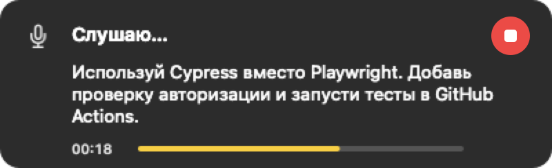
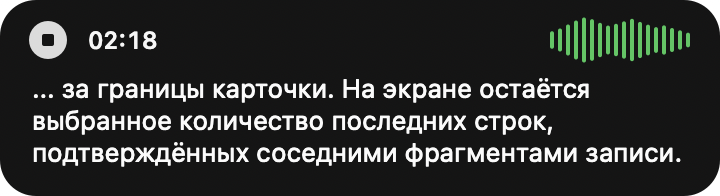
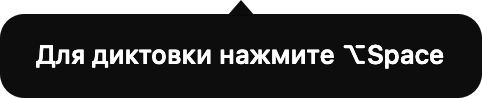

# Скриншоты Runvoice

Сняты встроенным отладочным рендером приложения (`--snapshot-states`, `--snapshot` и `--snapshot-hint`),
поэтому не требуют разрешения Screen Recording. Тема соответствует системной.

## Состояния HUD

| Состояние | Что показывает |
|---|---|
|  | `preparing` — «Готовлю микрофон…» |
|  | `recording` — таймер, текущий зелёный спектр, залитая иконка остановки |
|  | `recording-quiet` — заметный отклик тихого звука |
|  | `recording-silent` — короткие штрихи тишины |
|  | `recording-live` — стабильный предварительный текст во время записи |
|  | `recording-long` — длинная диктовка, до трёх последних строк; `... ` обозначает скрытое начало |
|  | `transcribing` — «Распознаю…» со спиннером, без черновика |
|  | `fixing` — «Обрабатываю текст…» с тем же спиннером, без расшифровки |
|  | `done` — приложение-получатель и число слов, ширина по содержимому, скрывается через 1 с |
|  | `done-short` — короткое название и одно слово |
|  | `done-long` — длинное название и трёхзначный счётчик |
|  | `done-copied` — вставка не отправлена, текст доступен в буфере |
|  | `info` — «Запись не идёт», синяя иконка |
|  | `error` — «Речь не распознана (тишина?)», оранжевый треугольник |
|  | `improve` — «Улучшаю текст…» с тем же спиннером |
|  | `improve-copied` — «Улучшено и скопировано», синяя иконка |

## Настройки

| Вкладка | Файл |
|---|---|
| Основные (микрофон, автозапуск, диагностика) | [settings-general.png](settings-general.png) |
| Распознавание (язык, Whisper / Nemotron, предпросмотр и число строк, модели) | [settings-models.png](settings-models.png) |
| Словарь (редактируемые строки и добавление списка) | [settings-dictionary.png](settings-dictionary.png) |
| Провайдеры (OpenCode / OpenAI / Anthropic, модели, ключи, проверка) | [settings-providers.png](settings-providers.png) |
| Постобработка (выбор провайдеров, промпты) | [settings-ai.png](settings-ai.png) |
| Постобработка → улучшение выделенного текста | [settings-improve.png](settings-improve.png) |
| История (список, копирование, лимиты) | [settings-history.png](settings-history.png) |
| Хоткеи (диктовка, улучшение, завершение по Enter, отмена по Esc, конфликты macOS) | [settings-hotkeys.png](settings-hotkeys.png) |

## Хинт запуска



Хинт содержит настроенный хоткей и хвостик к значку строки меню. Он показывается
один раз при запуске, скрывается через 4 с либо при клике, открытии меню или
начале диктовки. Клик запускает затухание за 150 мс. PNG содержит только карточку.

## Оформление и размеры

- Основной HUD — чёрная скруглённая карточка без хвостика. Позиция мыши фиксируется
  в момент хоткея; центральная ось и край привязки сохраняются во всех состояниях.
- Запись показывает таймер, залитую иконку отмены с символом просветом и зелёный
  спектр 72 × 24 pt. Его 18 полос отражают текущий звук без прокрутки истории.
- Низкий уровень виден в quiet, тишина — в silent. Центры иконок и текста совпадают.
- Подготовка использует системный микрофон в круге. Распознавание, правка и
  улучшение показывают одинаковый светлый спиннер; ошибка — оранжевый треугольник.
- Запись без предпросмотра занимает 40 pt по высоте, с тремя строками — до 98 pt.
  Остальные карточки имеют высоту 40 pt и ширину по содержимому до 360 pt.
- Предпросмотр ограничен 1–10 строками, по умолчанию тремя. При скрытом начале
  `... ` входит в лимит строк; полный результат используется для вставки и истории.
- Квитанция успеха содержит иконку и имя получателя, число слов и скрывается через 1 с.
  После завершения или ошибки строка меню показывает исходный значок Runvoice.

Рядом с PNG HUD создаётся JSON с размерами, подписями, центрами `rowCenters`,
числом строк, размерами спектра и `spinnerRunning`. Размеры указаны в pt;
рендер HUD создаёт PNG 2× независимо от дисплея. Снимок словаря использует
демонстрационные термины, не сохраняемые в настройках.

Частота обновлений оценивается по [временной трассе](../testing.md#измерение-задержек),
а не по статичному изображению. Исторические материалы — в [CHANGELOG](../../CHANGELOG.md).

## Как переснять

Запустить отдельный процесс установленного приложения:

```sh
/Applications/Runvoice.app/Contents/MacOS/Runvoice --snapshot-states
/Applications/Runvoice.app/Contents/MacOS/Runvoice --snapshot
/Applications/Runvoice.app/Contents/MacOS/Runvoice --snapshot-hint
```

Режимы снимков не открывают микрофон, не регистрируют глобальные хоткеи и не
сбрасывают status рабочей диктовки. Для рендера нужна графическая сессия macOS,
разрешение Screen Recording не требуется. Тема настроек соответствует системной.

Для публикации снимков настроек используйте отдельный каталог с демонстрационными
данными. `CFFIXED_USER_HOME` задаёт корень пользовательских путей только тестовому
процессу; `settings.json` и `history.json` он читает из
`Library/Application Support/Runvoice/` внутри этого каталога. Не помещайте туда
личную историю или API-ключи.

```sh
runvoice_snapshot_home="$(mktemp -d /tmp/runvoice-snapshot.XXXXXX)"
mkdir -p "$runvoice_snapshot_home/Library/Application Support/Runvoice"
# При необходимости подготовить демонстрационные settings.json и history.json.
env CFFIXED_USER_HOME="$runvoice_snapshot_home" \
  /Applications/Runvoice.app/Contents/MacOS/Runvoice --snapshot
```

Файлы появляются в `/tmp/runvoice-state-*.png`, `/tmp/runvoice-settings*.png` и
`/tmp/runvoice-startup-hint.png`. Сохранить нужные изображения под именами из таблиц.
Для проверки переноса добавить `--snapshot-preview-lines 1` либо
`--snapshot-preview-lines 10`, для записи без текста — `--snapshot-preview-off`.
Эти флаги не сохраняются в настройках.
