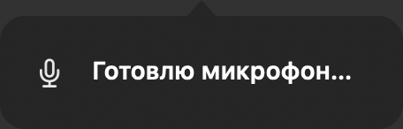
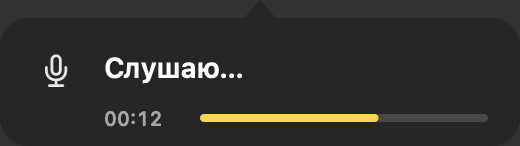
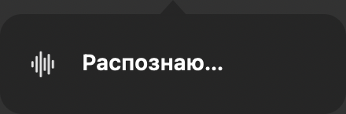
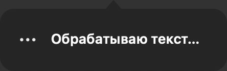
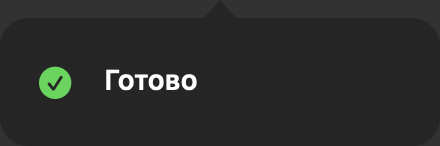
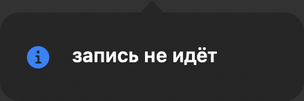

# Скриншоты Runvoice

Сняты встроенным отладочным рендером приложения (`--snapshot-states` и `--snapshot`),
поэтому не требуют разрешения Screen Recording. Тёмная тема.

## Состояния HUD

| Состояние | Что показывает |
|---|---|
|  | `preparing` — «Готовлю микрофон…» |
|  | `recording` — «Слушаю…», таймер и уровень микрофона |
|  | `transcribing` — «Распознаю…» |
|  | `fixing` — «Обрабатываю текст…» |
|  | `done` — «Готово», зелёная галочка |
|  | `info` — «запись не идёт», синяя иконка |
|  | `error` — «речь не распознана (тишина?)», оранжевая иконка |

## Настройки

| Вкладка | Файл |
|---|---|
| General (язык, буфер, бабл, диагностика) | [settings-general.png](settings-general.png) |
| AI (провайдер, модель, URL, OpenCode) | [settings-ai.png](settings-ai.png) |
| Prompt (промпты fix/agent) | [settings-prompt.png](settings-prompt.png) |
| Hotkeys (диктовка, инструкция агенту) | [settings-hotkeys.png](settings-hotkeys.png) |

## Как переснять

```sh
# состояния HUD
open -a /Applications/Runvoice.app --args --snapshot-states

# вкладки настроек
open -a /Applications/Runvoice.app --args --snapshot
```

Файлы появятся в `/tmp/runvoice-state-*.png` и `/tmp/runvoice-settings*.png`.
