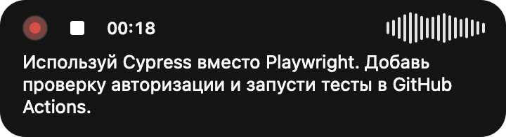
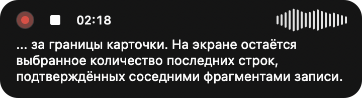
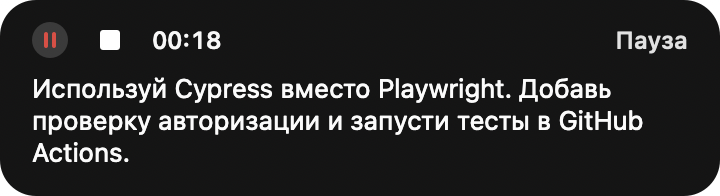
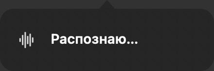
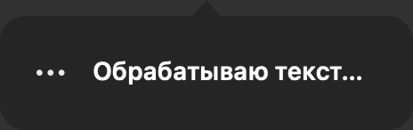
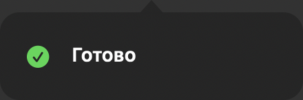
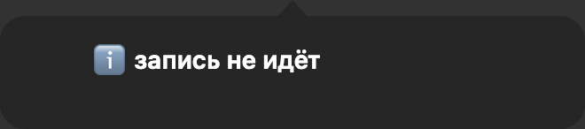

# Скриншоты Runvoice

Сняты встроенным отладочным рендером приложения (`--snapshot-states`, `--snapshot`,
`--snapshot-hint`, `--snapshot-transcribe` и `--snapshot-transcribe-summary`),
поэтому не требуют разрешения Screen Recording. Настройки сняты в светлой теме; тему снимка можно выбрать переменной `RUNVOICE_SNAPSHOT_APPEARANCE` (`light` или `dark`).

## Состояния HUD

| Состояние | Что показывает |
|---|---|
|  | `preparing` — «Готовлю микрофон…» |
|  | `recording` — таймер, текущий белый спектр, красная точка записи с заполненной аурой и стоп слева |
|  | `recording-hover` — красный символ паузы при наведении, запись, спектр и аура продолжаются |
|  | `recording-loud` — громкий звук, расширенная заполненная аура |
|  | `recording-transition` — промежуточная форма круга при превращении в паузу |
|  | `recording-resumed` — продолжение записи, аура и спектр снова активны |
|  | `recording-quiet` — заметный отклик тихого звука |
|  | `recording-silent` — короткие штрихи тишины |
|  | `recording-live` — стабильный предварительный текст во время записи |
|  | `recording-long` — длинная диктовка, до трёх последних строк; `... ` обозначает скрытое начало |
|  | `paused` — замерший таймер, красный символ паузы в сером круге слева, «Пауза» вместо спектра |
|  | `paused-live` — пауза с текстом, дополненным до границы остановки микрофона |
|  | `transcribing` — «Распознаю…» со спиннером, без черновика |
|  | `fixing` — «Обрабатываю текст…» с тем же спиннером, без расшифровки |
|  | `done` — приложение-получатель и число слов, ширина по содержимому, скрывается через 1 с |
|  | `done-short` — короткое название и одно слово |
|  | `done-long` — длинное название и трёхзначный счётчик |
|  | `done-copied` — вставка не отправлена, текст доступен в буфере |
|  | `info` — «Запись не идёт», синяя иконка |
|  | `error` — «Речь не распознана (тишина?)», оранжевый треугольник |
|  | `improve` — «Улучшаю текст…» с тем же спиннером |
|  | `improve-copied` — «Улучшено и скопировано», синяя иконка |

## Расшифровка аудио

| Окно | Файл |
|---|---|
| Транскрибация (режим, бейджи, метаданные, поиск, экспорт) | [transcribe.png](transcribe.png) |
| Саммари (пресеты промпта, результат; выбор файла скрыт) | [transcribe-summary.png](transcribe-summary.png) |

## Настройки

| Раздел | Файл |
|---|---|
| Основные (микрофон, вставка, запуск, разрешения и диагностика, обновления) | [settings-general.png](settings-general.png) |
| Распознавание: whisper.cpp, подсказка языка и модели Whisper | [settings-models.png](settings-models.png) |
| Распознавание: FluidAudio, подсказка выбранной модели и совместимый каталог | [settings-fluid.png](settings-fluid.png) |
| Отдельное окно резервного распознавания Whisper для FluidAudio | [settings-backup.png](settings-backup.png) |
| Словарь (пояснение применения, карточка терминов и добавление списка) | [settings-dictionary.png](settings-dictionary.png) |
| Провайдеры (список профилей, меню действий, добавление) | [settings-providers.png](settings-providers.png) |
| Постобработка (выбор провайдеров, промпты) | [settings-ai.png](settings-ai.png) |
| Постобработка → улучшение выделенного текста | [settings-improve.png](settings-improve.png) |
| Постобработка → промпт саммари аудио | [settings-summary.png](settings-summary.png) |
| История (хранение, поиск, список и выбранная запись) | [settings-history.png](settings-history.png) |
| Хоткеи (диктовка, улучшение, Enter, Esc, пауза по Space, конфликты macOS) | [settings-hotkeys.png](settings-hotkeys.png) |
| API: включение, порт, адрес, выбор скачанной модели, фильтр громкости/VAD, словарь и отдельная AI-правка | [settings-api.png](settings-api.png) |
| Скрытая модалка аудиосэмплов: четыре клика по версии | [settings-samples.png](settings-samples.png) |
| Сэмпл в процессе записи: индикатор, секунды, стандартный эквалайзер | [settings-sample-recording.png](settings-sample-recording.png) |

Тёмная тема:

| Раздел | Файл |
|---|---|
| Основные | [settings-general-dark.png](settings-general-dark.png) |
| Распознавание | [settings-models-dark.png](settings-models-dark.png) |
| API | [settings-api-dark.png](settings-api-dark.png) |

## Хинт запуска


Хинт содержит настроенный хоткей и хвостик к значку строки меню. Он показывается
один раз при запуске, скрывается через 4 с либо при клике, открытии меню или
начале диктовки. Клик запускает затухание за 150 мс. PNG содержит только карточку.

## Оформление и размеры

Окно настроек — боковой список 236 pt и область контента до 700 pt; настройки
собраны в карточки со строками «заголовок, пояснение, контрол справа». Окно
не меньше 1020 × 680 pt и не меняет размер при переключении разделов.

- Основной HUD — чёрная скруглённая карточка без хвостика. Позиция мыши фиксируется
  в момент хоткея; центральная ось и край привязки сохраняются во всех состояниях.
- Запись показывает слева красную точку 8 pt в сером круге 18 pt, затем стоп
  (белый квадрат без обводки) и таймер. Справа — белый спектр 72 × 24 pt.
  Его 18 полос отражают текущий звук без прокрутки истории.
- Вокруг точки — заполненная полупрозрачная красная аура внутри серого круга.
  Её диаметр и прозрачность следуют шести наиболее высоким полосам с диапазоном,
  подобранным по локальным сэмплам речи. Только аура нарастает и спадает плавно
  (100/320 мс); правый спектр реагирует мгновенно с исходной чувствительностью,
  без затухания и без изменения аудио для ASR.
  Наведение превращает круг в штрихи паузы за 180 мс, аура продолжает двигаться
  по громкости до клика или Space. Область нажатия — 22 × 22 pt.
- Низкий уровень виден в quiet, тишина — в silent. Центры иконок и текста совпадают.
- Пауза сохраняет размер, позицию и текст карточки; в слоте спектра показаны
  только подпись «Пауза», а первая кнопка слева показывает красные штрихи
  паузы в том же сером круге, без ауры. Клик продолжает запись. Стоп остаётся рядом. Таймер не включает время
  паузы, текст дополняется распознанным хвостом; после продолжения отсчёт и предпросмотр не начинаются заново.
- Подготовка использует системный микрофон в круге. Распознавание, правка и
  улучшение показывают одинаковый светлый спиннер; ошибка — оранжевый треугольник.
- Запись без предпросмотра занимает 40 pt по высоте, с тремя строками — до 98 pt.
  Остальные карточки имеют высоту 40 pt и ширину по содержимому до 360 pt.
- Предпросмотр ограничен 1–10 строками, по умолчанию тремя. При скрытом начале
  `... ` входит в лимит строк; полный результат используется для вставки и истории.
- Квитанция успеха содержит иконку и имя получателя, число слов и скрывается через 1 с.
  После завершения или ошибки строка меню показывает исходный значок Runvoice.

Рядом с PNG HUD создаётся JSON с размерами, подписями, центрами `rowCenters`,
числом строк, размерами спектра, `spinnerRunning`, `paused` и видимостью
индикатора паузы, `controlsVisible`, `pauseAction`, `pauseGlyph`, `pauseDiameter`,
`recordDiameter`, `recordingPulseVisible` и координатами кнопок/таймера. Размеры указаны в pt;
рендер HUD создаёт PNG 2× независимо от дисплея. Аура на PNG соответствует показанному уровню спектра;
по статичному снимку нельзя проверить отклик ауры во времени. Модалка сэмпла в состоянии записи использует демонстрационные уровни и таймер, без захвата микрофона. Снимок словаря использует
демонстрационные термины, не сохраняемые в настройках.

Частота обновлений оценивается по [временной трассе](../testing.md#измерение-задержек),
а не по статичному изображению. История опубликованных выпусков — в [CHANGELOG](../../CHANGELOG.md).

## Как переснять

Запустить отдельный процесс установленного приложения:

```sh
/Applications/Runvoice.app/Contents/MacOS/Runvoice --snapshot-states
/Applications/Runvoice.app/Contents/MacOS/Runvoice --snapshot
/Applications/Runvoice.app/Contents/MacOS/Runvoice --snapshot-hint
/Applications/Runvoice.app/Contents/MacOS/Runvoice --snapshot-transcribe
/Applications/Runvoice.app/Contents/MacOS/Runvoice --snapshot-transcribe-summary
```

Режимы снимков не открывают микрофон, не регистрируют глобальные хоткеи и не
сбрасывают status рабочей диктовки. Для рендера нужна графическая сессия macOS,
разрешение Screen Recording не требуется. Тема снимка настроек задаётся переменной `RUNVOICE_SNAPSHOT_APPEARANCE`; без неё используется системная.

Для публикации снимков настроек используйте отдельный каталог с демонстрационными
данными. `CFFIXED_USER_HOME` задаёт корень пользовательских путей только тестовому
процессу; `settings.json` и `history.json` он читает из
`Library/Application Support/Runvoice/` внутри этого каталога. Не помещайте туда
личную историю или API-ключи.

```sh
runvoice_snapshot_home="$(mktemp -d /tmp/runvoice-snapshot.XXXXXX)"
mkdir -p "$runvoice_snapshot_home/Library/Application Support/Runvoice"
# При необходимости подготовить демонстрационные settings.json и history.json.
env CFFIXED_USER_HOME="$runvoice_snapshot_home" \
  /Applications/Runvoice.app/Contents/MacOS/Runvoice --snapshot
```

Файлы появляются в `/tmp/runvoice-state-*.png`, `/tmp/runvoice-settings*.png`
(включая `samples` и `sample-recording`), `/tmp/runvoice-startup-hint.png`,
`/tmp/runvoice-transcribe.png` и `/tmp/runvoice-transcribe-summary.png`.
Сохранить нужные изображения под именами из таблиц.
Для проверки переноса добавить `--snapshot-preview-lines 1` либо
`--snapshot-preview-lines 10`, для записи без текста — `--snapshot-preview-off`.
Эти флаги не сохраняются в настройках.

Для снимка отдельного резервного окна выбрать FluidAudio в демонстрационных
настройках и добавить `--snapshot-backup` к `--snapshot`. Дополнительный файл —
`/tmp/runvoice-settings-backup.png`. Окно содержит только каталог Whisper;
скачивание и экспериментальные модели видны независимо от основной технологии.

## Индикатор обновления в строке меню

Оранжевая точка сообщает о новой версии независимо от текущего символа приложения.

| Тема | Ожидание | Запись | Пауза | Обработка |
|---|---|---|---|---|
| Светлая | [idle](update-light-idle.png) | [recording](update-light-recording.png) | [paused](update-light-paused.png) | [processing](update-light-processing.png) |
| Тёмная | [idle](update-dark-idle.png) | [recording](update-dark-recording.png) | [paused](update-dark-paused.png) | [processing](update-dark-processing.png) |
